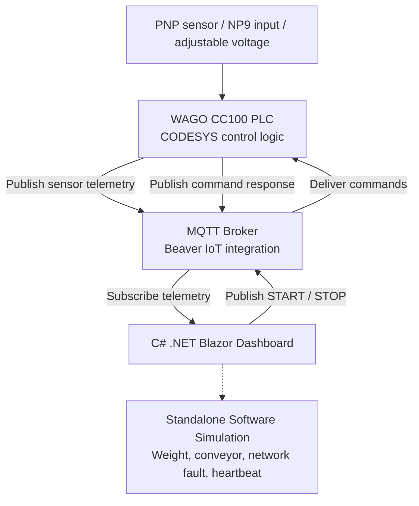

# Industrial IIoT Monitoring Dashboard

### Smart Conveyor Weight Monitoring and Overload Detection System

**TMS202/04 — IoT Sensing Devices and Interfaces | CA2 Project**

An educational Industrial Internet of Things (IIoT) prototype built with **WAGO Compact Controller 100 (751-9301), CODESYS, MQTT, Beaver IoT, C# .NET 10, and Blazor**.

> **Project scope:** The conveyor is visualised in software, and product weight is an engineering simulation derived from input voltage (weight in kg = voltage / 10). No calibrated load cell or physical conveyor motor is controlled by the dashboard.

## 1. Introduction

This project demonstrates an IIoT approach to monitoring a smart conveyor's sensing, operation and overload conditions. The WAGO CC100 processes industrial inputs, publishes telemetry to an MQTT broker, and receives remote START/STOP requests. A C# Blazor dashboard subscribes to telemetry, displays PNP detection and voltage-derived weight, and provides operating status, alarms, fault indications and event history.

A standalone **Simulation Mode** demonstrates NP9 push-button actions, PNP detection, weight changes, conveyor animation and communication faults without a physical PLC connection.

**Dashboard showcase:** A screenshot of the running dashboard will be added once the project image assets are uploaded.

<!-- After uploading an actual screenshot to docs/images/dashboard-overview.png:

-->

## 2. Project Objectives

- Integrate PLC sensing and control with MQTT-based IIoT communication.
- Display live input measurements, PNP status and PLC run state.
- Demonstrate both **MQTT Subscribe** (telemetry) and **MQTT Publish** (START/STOP commands).
- Apply a configurable weight threshold and show overweight alerts.
- Provide a conveyor visualisation and standalone software simulation.
- Detect missing telemetry and demonstrate network-fault/heartbeat-timeout recovery.
- Maintain timestamped system events, alarms and diagnostic information.

## 3. System Architecture

**Data flow:** The PLC generates measurement and status data; the broker exchanges MQTT messages; and the Blazor web application presents operator-facing monitoring and control. Command execution is confirmed only when the application receives a matching device acknowledgement.

**Main components:** WAGO CC100 (751-9301), PNP proximity sensor, NP9 push button, associated industrial power and communication hardware, CODESYS, Beaver IoT MQTT integration and the Blazor web dashboard.

## 4. Key Features

| Feature | Description |
|---|---|
| Real-time sensor monitoring | PNP detection, PLC run state, voltage and telemetry freshness |
| Weight threshold alert | Adjustable limit and overweight indication using simulated engineering weight |
| MQTT two-way messaging | Telemetry subscription and START/STOP command publication |
| Command acknowledgement | Command IDs, pending state and acknowledgement timeout |
| Conveyor visualisation | Animated demonstration of product movement and inspection outcomes |
| Simulation Mode | Local NP9, PNP and weight controls without a PLC |
| Fault detection | Live-telemetry freshness checks and simulated network-fault/heartbeat-timeout warnings |
| Event history | Timestamped status changes, alarms and recovery notifications |

## 5. Technologies Used

| Technology | Role |
|---|---|
| WAGO CC100 (751-9301) | Industrial edge controller |
| CODESYS | PLC input handling and control logic |
| MQTT | Publish/subscribe communication |
| Beaver IoT | MQTT integration and device identification |
| C# / .NET 10 | Application framework |
| Blazor Server | Interactive browser dashboard |
| MQTTnet | MQTT client library |

## 6. Operation Modes

### WAGO MQTT Monitoring

Receives telemetry from the real MQTT broker and displays the latest available PLC readings. It can publish START/STOP commands to the controller's **internal RunEnable test state**, not a physical conveyor motor.

### Simulation Mode

Simulates PNP detection, NP9 interaction and voltage-equivalent weight monitoring locally. It also supports a software-only **Simulate Network Loss** test: simulated data becomes unavailable, the conveyor visualisation stops, and the simulated heartbeat times out. **Restore Network** resumes simulated communication and logs recovery.

> The real broker connection shown in the MQTT panel is separate from the simulated PLC communication status; a simulation fault does not physically disconnect MQTT.

## 7. Testing and Validation

Recommended demonstration sequence:

1. Confirm normal dashboard monitoring and simulated conveyor operation.
2. Move the weight control above the configured threshold to verify the overweight alert.
3. In Simulation Mode, select **Simulate Network Loss** and observe **COMMUNICATION LOST**, **SIMULATED PLC OFFLINE**, and **NO DATA**.
4. Verify that missing simulated heartbeat updates cause **HEARTBEAT TIMEOUT** after the six-second threshold measured from the last heartbeat.
5. Select **Restore Network**, confirm recovery, and review timestamped entries in **Event History**.
6. Where hardware is available, separately test MQTT telemetry, START/STOP publication and matching acknowledgement.

**Evidence gallery:** Add project screenshots to `docs/images/` and enable the examples below when the files exist:

<!--
### Dashboard — Normal Operation

### Network Fault Detection

### Heartbeat Timeout and Event History

### Network Recovery

-->

**Validation boundary:** Simulation tests show the web application's responses to injected faults. They do **not** prove real PLC power-loss, sensor-disconnection or Ethernet-cable-failure detection.

## 8. Security Considerations

Beaver IoT MQTT integration uses configured credentials. Do not commit MQTT passwords, tokens, certificates or secret environment variables to this repository. For a production network, consider TLS, broker topic-level permissions, restricted network access and appropriate PLC/hardware safety mechanisms.

## 9. Running the Project

1. Install the **.NET 10 SDK** and open the solution in Visual Studio.
2. Open `CA2_Project File.slnx` or the nested project solution.
3. Restore NuGet dependencies (the project uses MQTTnet).
4. Run the Blazor application and browse to **`/industrial-dashboard`**.
5. Choose **Simulation Mode** to explore local features without PLC hardware.
6. For live monitoring, configure a reachable MQTT broker and set the required `BEAVER_MQTT_PASSWORD` environment variable; select **WAGO MQTT Monitoring** and connect.

**Configuration note:** Broker address, credentials and topics in the checked-in application may be specific to the development environment. Verify settings locally before testing live MQTT; avoid publishing credentials.

## 10. Project Scope and Limitations

This is an educational IIoT prototype. The weight calculation is not a calibrated measurement, and conveyor movement is animated. A simulated network fault is not equivalent to a disconnected real PLC. Physical actuator safety, accurate sensing and industrial deployment require separate hardware verification, interlocks and commissioning.

---
**Project:** TMS202/04 — Industrial IIoT Monitoring Dashboard
