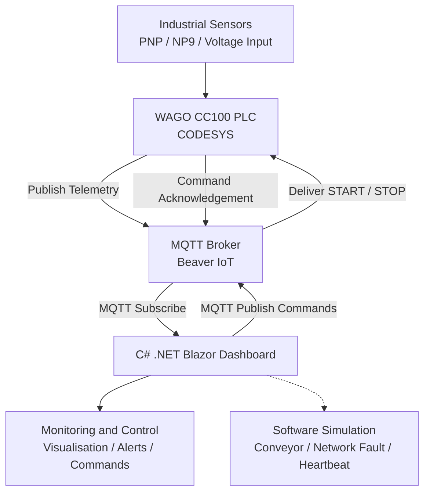

# Industrial IIoT Monitoring Dashboard

### Smart Conveyor Weight Monitoring and Overload Detection System

**TMS202/04 – IoT Sensing Devices and Interfaces | CA2 Project**

An Industrial Internet of Things (IIoT) monitoring and control application developed using **WAGO Compact Controller 100 (751-9301), CODESYS, MQTT, Beaver IoT, C# .NET 10 and Blazor**.

---

## 1. Introduction

This project focuses on the development of an Industrial Internet of Things (IIoT) monitoring and control system for a smart conveyor application. The system integrates industrial sensing devices, a programmable logic controller (PLC), MQTT communication and a web-based dashboard to support real-time monitoring, remote control, overload detection and fault monitoring.

The WAGO Compact Controller 100 (751-9301) serves as the industrial edge controller, collecting sensor information and processing control logic through CODESYS. Sensor data is transmitted through an MQTT broker integrated with Beaver IoT and visualised using a C# .NET Blazor dashboard.

The application includes PNP sensor monitoring, simulated product weight measurement, configurable overload detection, conveyor visualisation, MQTT-based START/STOP commands and event logging.

A standalone Simulation Mode is also provided to demonstrate system operation, network faults, heartbeat timeout detection and recovery without requiring continuous access to the physical WAGO PLC.

## 2. Project Objectives

The main objectives of this project are:

- Develop an IIoT monitoring and control system integrating industrial sensors, PLC programming and MQTT communication.
- Display real-time sensor readings and operating conditions through an interactive web-based dashboard.
- Implement MQTT Subscribe and Publish for bidirectional communication between the PLC and the dashboard.
- Provide configurable weight thresholds and automatic overweight alerts.
- Simulate conveyor operation, product detection and weight inspection.
- Implement communication fault detection using telemetry monitoring and heartbeat mechanisms.
- Record system events, alarm conditions and recovery activities.
- Validate system behaviour through functional testing and software-based fault simulations.

## 3. System Architecture

The IIoT system consists of industrial sensing devices, a WAGO PLC, an MQTT broker and a C# .NET Blazor web application.

### 3.1 Industrial Hardware

The hardware platform includes:

- WAGO Compact Controller 100 (751-9301)
- 24V DIN-Rail Power Supply
- PNP Proximity Sensor
- NP9 Push Button
- LED Indicator
- Industrial communication and terminal modules
- Ethernet networking equipment

### 3.2 PLC Programming

CODESYS is used to implement sensor processing, operating logic, MQTT communication and the internal RunEnable control state.

### 3.3 MQTT Communication

The MQTT broker provides a communication interface between the WAGO PLC and the Blazor dashboard.

The PLC publishes sensor telemetry, while the web application subscribes to incoming measurements and publishes remote control commands.

### 3.4 Web Application

The Blazor dashboard provides real-time monitoring, configurable alarms, remote control, conveyor visualisation, communication diagnostics and event history.

## 4. Key Features

### 4.1 Real-Time Sensor Monitoring

The dashboard monitors and displays:

- PNP proximity sensor detection status
- Voltage measurements
- Voltage-derived simulated product weight
- PLC RunEnable state
- Device communication status
- MQTT telemetry freshness
- Physical input event counters, where available

The system updates the displayed measurements according to the incoming MQTT telemetry.

### 4.2 Weight Monitoring and Overload Detection

The application converts the received voltage value into a simulated engineering weight using:

**Weight (kg) = Voltage / 10**

A configurable weight threshold allows the operator to define the maximum permitted product weight.

The dashboard displays:

- NORMAL when the weight is within the configured limit.
- OVERWEIGHT when the weight exceeds the configured limit.
- NO DATA when valid monitoring information is unavailable.

Overweight conditions and recovery events are recorded in the Event History.

**Note:** The weight value is an engineering simulation. No calibrated physical load cell is connected.

### 4.3 MQTT Subscribe and Publish

The application supports bidirectional MQTT communication.

**MQTT Subscribe**

The dashboard receives telemetry data published by the WAGO controller, including sensor status, voltage measurements and internal operating information.

**MQTT Publish**

The dashboard can publish remote START and STOP commands through the MQTT broker.

Each command includes a unique Command ID to support acknowledgement tracking.

The application monitors command states such as:

- PENDING
- ACKNOWLEDGED
- TIMEOUT
- PUBLISH FAILED

A matching acknowledgement is required to confirm that the command has been processed by the connected device.

Remote START/STOP changes the PLC's internal RunEnable test state and does not operate a physical conveyor motor.

### 4.4 Conveyor Visualisation

The dashboard includes an animated conveyor visualisation to demonstrate product movement and inspection.

The visualisation represents:

- Conveyor RUNNING and STOPPED conditions
- Product approach and detection
- PNP sensor activation
- Product weight inspection
- PASS and REJECT conditions
- Communication unavailable conditions

This feature provides a visual demonstration of the monitoring and inspection process.

### 4.5 Network Fault Detection

The application includes a Network Fault Simulation function.

When a simulated communication failure is activated:

- System Status displays COMMUNICATION LOST.
- Device Health displays SIMULATED PLC OFFLINE.
- Sensor readings become unavailable.
- The conveyor visualisation stops.
- Weight alarm evaluation is suspended.
- A fault event is recorded in Event History.

The function demonstrates how the dashboard responds when monitoring information becomes unavailable.

### 4.6 Heartbeat Monitoring

The Simulation Mode includes a heartbeat monitoring mechanism to detect missing communication updates.

**Heartbeat Configuration**

| Parameter | Setting |
|---|---|
| Heartbeat Interval | 2 seconds |
| Timeout Threshold | 6 seconds |
| Fault Indication | HEARTBEAT TIMEOUT |
| Recovery Indication | HEARTBEAT ACTIVE |

During normal simulated operation, heartbeat updates are generated periodically.

When heartbeat updates stop for more than six seconds, the dashboard triggers a timeout warning and records the event.

The timeout is calculated from the last successful heartbeat update.

### 4.7 Event History and Alarm Logging

The dashboard maintains a timestamped Event History for important operating events.

Recorded events include:

- System initialisation
- Simulation Mode activation
- NP9 button operation
- PNP sensor changes
- Weight alarms and recovery
- MQTT connection changes
- Network faults
- Heartbeat timeouts
- Communication recovery
- Remote command acknowledgement and timeout

These records support troubleshooting and analysis of system behaviour.

## 5. Technologies Used

| Technology | Purpose |
|---|---|
| WAGO CC100 (751-9301) | Industrial edge controller |
| CODESYS | PLC programming and control logic |
| MQTT | Publish/Subscribe communication protocol |
| Beaver IoT | MQTT integration and device management |
| C# | Application programming language |
| .NET 10 | Web application framework |
| Blazor Server | Interactive monitoring dashboard |
| MQTTnet | MQTT client communication library |
| HTML / CSS / Bootstrap | Dashboard interface and styling |
| Visual Studio | Application development environment |

## 6. Operation Modes

The application provides two operating modes.

### 6.1 WAGO MQTT Monitoring Mode

WAGO MQTT Monitoring Mode receives telemetry data from the physical WAGO controller through the MQTT broker.

The dashboard displays:

- Live PNP sensor status
- Voltage measurements
- Simulated weight calculated from voltage
- PLC internal operating state
- Telemetry freshness
- MQTT connection status

Remote START and STOP commands can also be published through MQTT.

The weight input slider is disabled in this mode because the displayed weight depends on the incoming PLC measurement.

### 6.2 Simulation Mode

Simulation Mode allows the application to operate without connecting to the physical WAGO PLC.

Available simulation functions include:

- Manual weight adjustment
- NP9 push-button simulation
- PNP sensor detection simulation
- Conveyor operation visualisation
- Overweight threshold testing
- Network fault simulation
- Heartbeat pause and resume
- Communication recovery

Simulation Mode is useful for demonstrating system behaviour, testing dashboard functions and validating alarm indications.

## 7. Testing and Validation

Functional testing was carried out to evaluate the dashboard's software simulation features, communication fault detection and recovery behaviour.

### 7.1 Software Simulation Test Results

| Test Case | Observed Result | Status |
|---|---|---|
| Network Fault Detection | COMMUNICATION LOST displayed | PASS |
| Device Health Monitoring | SIMULATED PLC OFFLINE displayed | PASS |
| Sensor Data Availability | PNP and weight readings changed to NO DATA | PASS |
| Heartbeat Timeout | HEARTBEAT TIMEOUT warning triggered | PASS |
| Conveyor Fault Response | Conveyor stopped and displayed COMMUNICATION UNAVAILABLE | PASS |
| Fault Event Logging | Network fault and heartbeat timeout recorded | PASS |
| Network Recovery | Network status returned to NORMAL | PASS |
| Heartbeat Recovery | Heartbeat returned to ACTIVE | PASS |
| Conveyor Recovery | Simulated conveyor operation resumed | PASS |

### 7.2 Network Fault Demonstration

The network fault simulation was performed using the Simulate Network Loss function.

The dashboard immediately detected the simulated fault and displayed COMMUNICATION LOST and SIMULATED PLC OFFLINE.

Sensor data became unavailable, and the conveyor visualisation stopped.

The heartbeat mechanism subsequently detected missing updates and generated a HEARTBEAT TIMEOUT warning.

### 7.3 Event Logging Verification

The Event History recorded the following test events:

| Event | Recorded Time |
|---|---|
| Network Fault | 18:14:03 |
| Heartbeat Timeout | 18:14:08 |

The observed time difference was approximately five seconds.

This is consistent with the heartbeat timeout being calculated from the last successful heartbeat rather than from the moment the network fault was activated.

### 7.4 System Recovery

After selecting Restore Network, the dashboard returned to its normal simulated communication state.

The following recovery conditions were observed:

- Network Status: NORMAL
- Heartbeat Status: HEARTBEAT ACTIVE
- Simulated sensor data available
- Conveyor visualisation resumed
- Recovery events recorded in Event History

### 7.5 Testing Limitations

These results validate the application-level software simulation.

The simulated network fault does not physically disconnect the MQTT broker or WAGO controller.

Actual PLC power loss, Ethernet cable disconnection and physical sensor failures require separate hardware-based testing.

## 8. Security Considerations

Security is important in IIoT systems because unauthorised access may compromise sensor information or allow unintended control commands.

The MQTT integration uses configured username and password credentials.

Device identification is also used to associate incoming telemetry with the intended device.

However, device identification alone does not provide authentication or access control.

### Recommended Security Improvements

- MQTT communication over TLS
- Topic-level access permissions
- Network segmentation
- Secure credential management
- Restricted remote control access
- Periodic security configuration reviews

MQTT passwords, authentication tokens and other sensitive credentials should not be committed to the GitHub repository.

## 9. Installation and Setup

### 9.1 Prerequisites

Before running the project, ensure the following software is available:

- Visual Studio with ASP.NET and web development support
- .NET 10 SDK
- MQTTnet NuGet package
- A compatible MQTT broker for live monitoring
- WAGO CC100 and CODESYS for physical PLC integration

Simulation Mode does not require a physical PLC connection.

### 9.2 Running the Application

1. Clone or download this GitHub repository.
2. Open the project solution in Visual Studio.
3. Restore the required NuGet packages.
4. Build the solution.
5. Run the Blazor web application.
6. Open `/industrial-dashboard` in the browser.
7. Select Simulation Mode or WAGO MQTT Monitoring.

### 9.3 Simulation Mode Setup

1. Select Simulation Mode.
2. Adjust the simulated weight using the slider.
3. Press the NP9 simulation button to change the running state.
4. Toggle the PNP sensor to simulate object detection.
5. Observe the conveyor visualisation.
6. Trigger Network Fault to demonstrate communication failure.
7. Observe the heartbeat timeout warning.
8. Select Restore Network to resume simulated communication.

### 9.4 WAGO MQTT Monitoring Setup

1. Ensure the WAGO controller and MQTT broker are correctly configured.
2. Verify the broker address and MQTT topic settings.
3. Configure the required MQTT authentication credentials securely.
4. Start the Blazor application.
5. Select WAGO MQTT Monitoring.
6. Connect to the MQTT broker.
7. Verify that telemetry is received.
8. Test remote control commands only when the intended PLC test logic is ready.

The application uses the `BEAVER_MQTT_PASSWORD` environment variable for the MQTT password.

Do not store real passwords directly in public source code.

## 10. Project Scope and Limitations

This project is an educational IIoT prototype developed to demonstrate industrial sensor integration, MQTT communication, monitoring and software-based fault detection.

The system has several limitations:

- Product weight is calculated from an adjustable voltage value rather than a calibrated load cell.
- The conveyor animation represents a simulated process.
- Remote START and STOP commands control the PLC's internal test state rather than a physical conveyor motor.
- Network fault simulation does not physically interrupt the MQTT broker connection.
- The simulated heartbeat does not represent an independently transmitted physical PLC heartbeat.
- Physical equipment safety and actual industrial deployment require additional hardware validation.

These limitations provide opportunities for future improvements and further development.

## 11. Conclusion

The Industrial IIoT Monitoring Dashboard demonstrates the integration of industrial sensing, PLC programming, MQTT communication and web-based monitoring within a smart conveyor application.

The system provides sensor visualisation, configurable overweight detection, MQTT-based remote commands, conveyor simulation, communication fault indication and event logging.

Software simulation testing demonstrated that the dashboard can identify simulated network failures, detect heartbeat timeouts, indicate unavailable monitoring data and restore normal operation after recovery.

The project provides a foundation for further development of reliable IIoT monitoring and control applications, including physical sensor integration, enhanced cybersecurity and hardware-based failure detection.

---

**TMS202/04 – IoT Sensing Devices and Interfaces**

**Project: Smart Conveyor Weight Monitoring and Overload Detection System**

**Platform: WAGO CC100 | CODESYS | MQTT | Beaver IoT | C# .NET Blazor**
